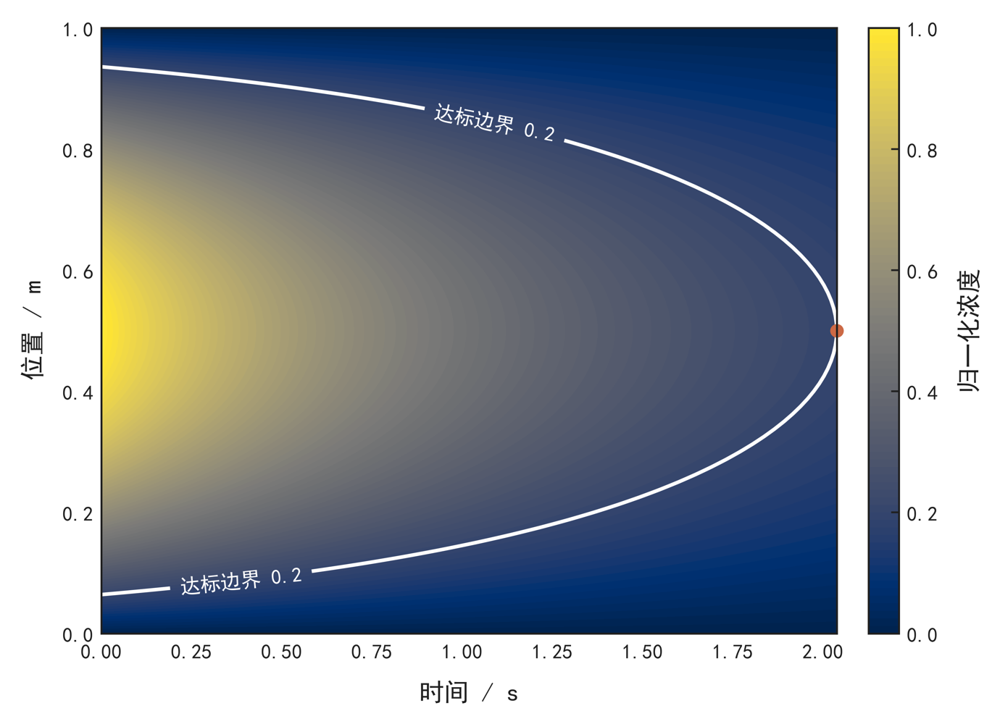

# zpb-math-modeling-agent

从题目和附件出发，由智能体完成中文数学建模论文：问题分析、高级数学建模、真实计算、独立科研图、近年文献、LaTeX排版与结果交付。

**显示名称：zpb-math-modeling-agent**  
**技能标识：`zpb-math-modeling-agent`**  
**许可证：MIT**

本技能将一篇完整建模论文最终交付时的工作方法整理为原创、可移植的技能包。方法由智能体根据新题目自主选择；Python工具负责可重复的计算辅助、核验与交付。使用者提供题目和可用工具环境后，可直接让智能体执行整套流程。

## 产出什么

- 中文论文PDF及可继续编辑的LaTeX工程；优先保留使用者给定的 `example.tex` 模板。
- 每问的模型、数学推导、算法、关键数值及具体结论。
- 充实的结果表、符号单位表、配置表和验证/敏感性/鲁棒性对照表，正文逐表解释。
- 来自真实数据或真实数值计算的独立图件，每幅PDF/SVG和600 dpi PNG，中文字体。
- 题目要求的Excel/CSV等完整结果文件，含采样、精度和布局约定。
- 敏感性分析、鲁棒性检验、收敛或基线对照，以及与问题相适配的不确定性分析。
- 近年文献与就近正文引用、可追溯的数值事实、计算配置、复现代码和提交包。

默认论文为七章结构，不单设文献综述。摘要按“总体说明 + 逐问的问题/模型/数值/结论 + 总结 + 关键词”组织；重要内容黑色加粗，实际编译确保摘要与关键词位于第一页。用户要求和正式模板优先。

## 安装

需要能读取文件、执行Python和编辑工程的智能体环境。使用Codex时，在仓库目录执行：

```bash
python scripts/install_skill.py
```

默认安装至 `~/.agents/skills/zpb-math-modeling-agent/`，再次更新使用 `--replace`，旧版会自动保留备份。需要兼容现有技能目录时可指定：

```bash
python scripts/install_skill.py --skills-root ~/.codex/skills
```

然后在新对话中选择 **zpb-math-modeling-agent**，或在消息中使用 `$zpb-math-modeling-agent`。其他兼容技能目录的智能体可读取本目录 `SKILL.md` 并按相同流程执行。

安装目录约定依据 [OpenAI官方技能文档](https://developers.openai.com/codex/skills/)。技能不需要私有API密钥，也不依赖开发者电脑上的其他skill。

## 直接使用

把题目、附件和可选模板放在同一工作目录，然后发送：

```text
使用 $zpb-math-modeling-agent 完成这个文件夹中的数学建模题目。
请先读题目和全部附件，自主选择适配的博士研究生层次数学方法，
实际运行计算，完成中文论文、独立高清图和题目要求的结果文件。
如果有example.tex，严格沿用它的模板；没有则用技能内置模板。
摘要逐问交代模型、关键数值和结论，占满第一页版心且不跨页。
重要内容黑色加粗，不单设文献综述，优先引用近年正式文献。
最后完成敏感性分析、鲁棒性检验、PDF和完整复现包。
```

仅提供题目时，智能体先提取题意和缺失数据，继续完成可计算部分；需要关键附件时一次列出。可选的导师思路作为方法候选，智能体根据数学结构、数据与计算成本筛选。

## 环境

建议Python 3.11或更新版本。常见科学计算、绘图及PDF检查依赖：

```bash
python -m pip install -r requirements.txt
python scripts/preflight.py --output environment.json
```

需要本地PDF时安装TeX Live或MiKTeX（含XeLaTeX、BibTeX及ctex）；采用biblatex/Biber的模板还需Biber。构建器自动选择后端，也支持手写参考文献列表。Poppler提供页面渲染，TeXstudio可用于本地编辑。脚本检查并报告依赖，系统软件由使用者按平台安装。

中文图优先使用SimHei，跨平台可安装Noto Sans CJK等字体。字体文件不随仓库分发。`acadplot`和`boviz`作为可选Python库单独列在 `requirements-optional.txt`，核心工具链使用Matplotlib即可运行。

## 工具链

以下命令通常由智能体调用，`PROJECT`代表新建的项目目录：

```bash
python scripts/init_project.py --output PROJECT --input problem.pdf --input data.xlsx
python scripts/export_tables.py PROJECT/data/table-spec.json --output PROJECT/tables
python scripts/verify_references.py requests.json --output PROJECT/notes/citation-evidence.json --bibtex PROJECT/references.bib --resolve-doi
python scripts/build_paper.py --project PROJECT
python scripts/audit_project.py --project PROJECT
python scripts/package_submission.py --project PROJECT
```

有模板时为初始化命令增加 `--template TEMPLATE_DIR`。复制的模板保留哈希基线，智能体将其正文入口和本地依赖准备到工程根目录，保留原件；例如运行 `python scripts/build_paper.py --project PROJECT --main example.tex`。成功构建后入口自动记录到 `project.json` 的 `manuscript.main`，审计、打包及后续构建沿用它。初始化拒绝覆盖已有非空工程。

文献核验输入示例：

```json
[
  {
    "key": "sanzalonso2023inverse",
    "doi": "10.1017/9781009414319",
    "claim": "正则化与贝叶斯反演的统一表述",
    "location": "问题四的反演模型"
  }
]
```

文献工具核对元数据，智能体继续阅读摘要或相关全文来核对引用论点。默认最近六个自然年；已核验出版日期的正式文献才能写入最终引用表。

初始化后的 `project.json` 用 `required_deliverables` 指定题目要求的最终文件。打包工具生成 `submission.zip`、`reproducibility.zip` 及SHA256清单，缺少规定结果会报错。

表格源规格保存在 `PROJECT/data/table-spec.json`，导出目录为 `PROJECT/tables`。复现包同时保留源规格、LaTeX表片、Excel和表格来源清单；题目明确要求提交的工作簿还需列入 `required_deliverables`。

## 科学与视觉标准

高级数学由任务驱动：PDE可使用弱形式、有限元/有限体积、自由边界和结构保持离散；反问题可使用正则化、伴随及贝叶斯；昂贵多次求解可使用POD-DEIM和谱代理；优化、图网络或预测任务则采用对应的高级方法。

每个方法有明确的推导、实现和验证状态。公式与计算接口对应，数值均可追溯。参数敏感性使用实际重算，代理使用独立样本验证，概率区间保留其定义与输入条件。

图件按信息选择：真实演化场、截面、等高线、达标边界、后验密度、误差谱、响应面和敏感性图。每幅独立制作，白底、清晰黑框、连续色阶、中文单位；复杂三维图须有可读的真实数据结构。

表格按科学问题规划：量化题每问至少一张关键结果表，另有符号/单位、求解配置、验证及适用的敏感性和鲁棒性表。样式沿用最终论文的普通紧凑三线表，居中、自然列宽、数值右对齐、普通表头，字体和间距继承模板；不强行拉满页面。`scripts/export_tables.py` 从同一结构化数据生成独立LaTeX表和Excel，显示精度与内部精度分别处理。详见 [表格设计](references/table-design.md)。



## 可运行示例

[解析扩散示例](examples/demo/README.md) 包含有解析解的真实数值求解、网格收敛、终点定位、Excel和单图导出：

```bash
python scripts/run_demo.py --output demo-output --compute-only
python scripts/run_demo.py --output demo-figure-output --figure field
```

`field`、`surface`、`convergence` 每次只选一种图。演示结果用于验收工具，不作为新题目的预设答案。

[最终药材案例经验](references/final-case-lessons.md) 记录最终版论文结构、数学主线、图件、引用和交付规则。本次原题、用户模板、原始附件及其他skill原文未进入公开发行包；使用者运行时可提供自己的材料。

## 检验与发布

### 批量处理

多题使用独立工程和任务清单，智能体逐题分析、计算、写作，再批量构建与交付：

```json
{"jobs":[{"id":"paper-001","title":"题目一","inputs":["question-1.pdf","data-1.xlsx"]},{"id":"paper-002","title":"题目二","inputs":["question-2.pdf"]}]}
```

```bash
python scripts/batch_projects.py --manifest cases/batch.json --output-root batch-output --stage initialize
python scripts/batch_projects.py --manifest cases/batch.json --output-root batch-output --stage build
python scripts/batch_projects.py --manifest cases/batch.json --output-root batch-output --stage audit
python scripts/batch_projects.py --manifest cases/batch.json --output-root batch-output --stage package
```

初始化与构建之间由智能体完成每题的模型、代码和正文；每次只续跑指定题目可增加 `--job paper-002`。工具核对输入哈希，单题失败不会阻断其余题的检查，汇总状态保存在批量输出目录。详细用法见 [批量工作流](references/batch-workflow.md)。

### 自动验证

```bash
python -m unittest discover -s tests -v
python scripts/validate_bundle.py
python scripts/make_release.py --output dist
```

GitHub Actions会运行离线行为测试和包检查。真实文献查询需要联网，实际LaTeX编译及中文字体图件还需要本地预检通过。发布包排除临时预览、旧稿、用户数据、环境依赖、编译缓存及本机路径。

本次实际验收范围和结果见 [VALIDATION.md](VALIDATION.md)，包括最终论文复建、新题完整交付、原论文表格样式及批量隔离验证。

## 目录

```text
SKILL.md                  智能体入口
agents/openai.yaml        中文名称与调用提示
scripts/                  初始化、计算演示、核验、绘图、编译、打包与安装
references/               方法路由、验证、写作、图件、引用与最终案例经验
assets/templates/         独立原创中文LaTeX骨架
assets/numeric-facts.schema.json
examples/demo/            演示说明与预览
tests/                    行为测试
```

贡献时先用一个新题目验证实际输出，再修改对应工具或说明。涉及第三方素材时记录来源和许可。详细边界见 [THIRD_PARTY_NOTICES.md](THIRD_PARTY_NOTICES.md)。
